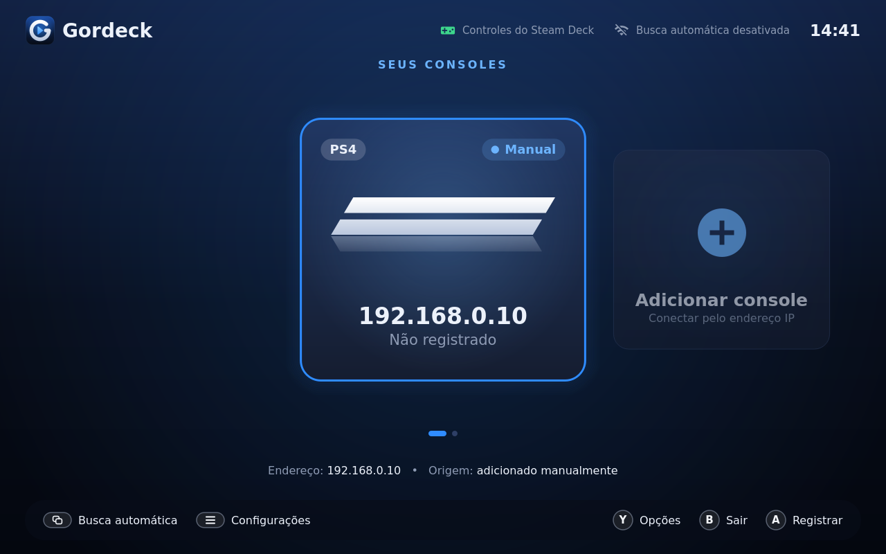
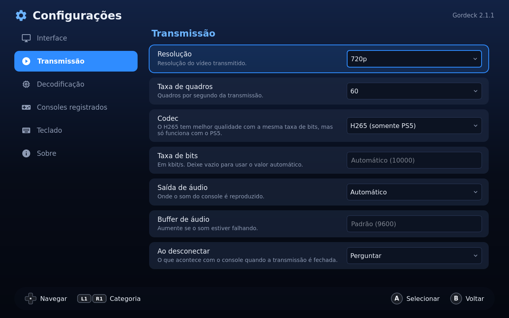
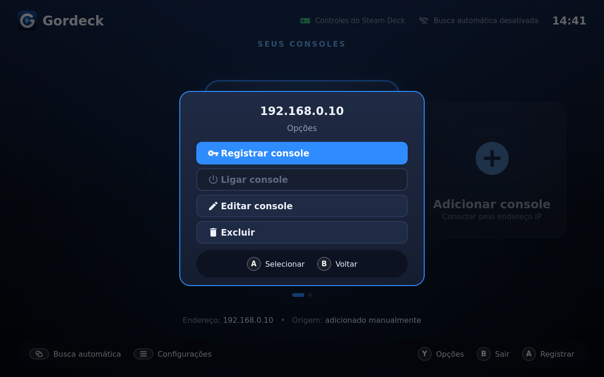

  

<h3 align="center">Jogue seu PlayStation no Steam Deck, do sofá, da cama ou de qualquer lugar da casa.</h3>

  
  
  

---

O **Gordeck** transmite os jogos do seu **PS5 ou PS4** para o **Steam Deck** pela rede de casa, com imagem, som e controle, como se você estivesse na frente da TV. Gratuito, de código aberto e feito para ser usado só com o controle: abriu, escolheu o console, apertou **A** e está jogando.

  

## Por que o Gordeck

🎮 **Feito para o controle.** Uma interface em tela cheia no estilo dos frontends de emulação, com carrossel de consoles, menus e janelas que você navega só com o direcional e os botões. Sem teclado, sem mouse.

⚡ **Um botão para jogar.** Se o console estiver em repouso, o Gordeck liga o PlayStation e começa a transmissão sozinho assim que ele estiver pronto.

🕹️ **Mostra os botões certos.** As dicas na tela se adaptam ao controle que você está usando: Steam Deck, DualSense/DualShock ou controle genérico.

🇧🇷 **Em português.** Toda a interface está em português do Brasil, com o inglês disponível nas configurações.

🖥️ **Tela sempre acesa.** Durante a transmissão, o Steam Deck não apaga a tela nem entra em repouso enquanto você joga só com o controle.

🚪 **Saída de emergência.** Segure o botão home por 7 segundos para encerrar a transmissão a qualquer momento.

📚 **Direto na biblioteca da Steam.** O instalador adiciona o Gordeck à Steam com ícone, capas e banner, pronto para abrir no modo Jogo.

  
  

## Instalação no Steam Deck

1. Mude para o **modo Desktop** (botão Steam › Ligar/desligar › Mudar para o modo Desktop).
2. Baixe o **`Gordeck-Instalador.tar.gz`** da [página de downloads](https://github.com/Brunnexo/gordeck/releases/latest) e extraia o arquivo.
3. Dê um duplo clique em **Instalar Gordeck** e siga as instruções.
4. Volte ao **modo Jogo**: o Gordeck estará na sua biblioteca, em **Não-Steam**.

O instalador cuida de tudo: baixa os componentes necessários, instala o app, traz os consoles que você já tinha registrado no Chiaki4deck e coloca o Gordeck na Steam. Use o mesmo instalador para atualizar ou desinstalar.

## Outras distribuições Linux

| Sistema | Download |
|---|---|
| Qualquer distribuição (Flatpak) | `gordeck.flatpak` › `flatpak install --user gordeck.flatpak` |
| Ubuntu 24.04 e derivados | `gordeck-*-ubuntu-24.04-*.deb` |
| Debian 12 | `gordeck-*-debian-12-*.deb` |
| Fedora 41 | `gordeck-*-fedora-41-*.rpm` |

Todos os arquivos estão na [página de downloads](https://github.com/Brunnexo/gordeck/releases/latest).

## Primeiros passos

1. Ligue o PlayStation e conecte o Steam Deck à **mesma rede** dele.
2. Abra o Gordeck. O console aparece sozinho na tela (ou use **Adicionar console** para informar o IP).
3. Selecione o console e aperte **A** para registrar. No PlayStation, abra **Configurações › Sistema › Reprodução Remota › Vincular dispositivo** e digite no Gordeck o PIN que aparecer.
4. Pronto! Daqui em diante, é só selecionar o console e apertar **A** para jogar.

> Para o PS4 e o PS5, o Gordeck também pede o **ID da sua conta PSN**. Veja como obter na [documentação do chiaki4deck](https://streetpea.github.io/chiaki4deck/setup/configuration/).

## Comandos

| Controle | Teclado | Ação |
|---|---|---|
| Direcional / analógico | ← → | Escolher o console |
| **A** | Enter | Conectar, registrar ou adicionar |
| **B** | Esc | Voltar / sair |
| **X** | W | Ligar o console |
| **Y** | O | Opções do console |
| **≡** Menu | F1 | Configurações |
| **⧉** View | F3 | Busca automática de consoles |
| Segurar **home** por 7 s | — | Encerrar a transmissão |

## Perguntas frequentes

**Preciso de um PlayStation Plus ou de alguma assinatura?**
Não. O Remote Play é um recurso gratuito do PS4 e do PS5.

**Funciona fora de casa?**
Funciona melhor na mesma rede Wi-Fi. Para jogar de fora, é preciso configurar o roteador; veja a [documentação do chiaki4deck](https://streetpea.github.io/chiaki4deck/).

**O controle não responde no Gordeck.**
Abra o Gordeck pela Steam (no modo Jogo ou como jogo não-Steam). Fora da Steam, o controle do Steam Deck não é reconhecido pelo app.

**Já usava o Chiaki4deck. Perco meus consoles?**
Não. O instalador importa os consoles registrados para o Gordeck.

## Créditos

O Gordeck nasceu do [chiaki4deck](https://streetpea.github.io/chiaki4deck/), de Street Pea, que por sua vez é baseado no [Chiaki](https://git.sr.ht/~thestr4ng3r/chiaki), de thestr4ng3r. Obrigado a todos que contribuíram com esses projetos.

Quer compilar ou contribuir? Veja o [guia de desenvolvimento](DESENVOLVIMENTO.md).

## Licença

Software livre, distribuído sob a [GNU Affero General Public License versão 3](COPYING).

PlayStation, PS4, PS5 e DualSense são marcas da Sony Interactive Entertainment. Steam e Steam Deck são marcas da Valve Corporation. O Gordeck é um projeto independente, sem relação com a Sony ou a Valve, e não é endossado nem certificado por elas.
